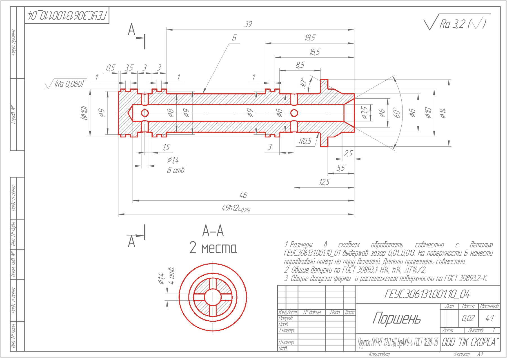
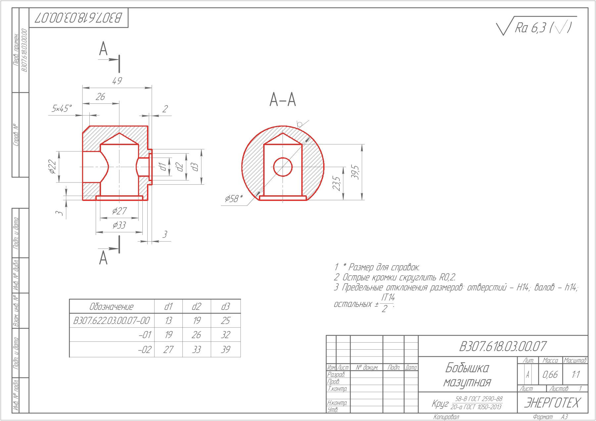
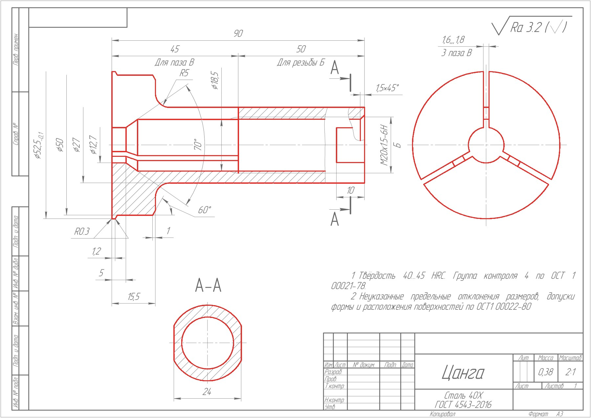

# Выделение основных линий чертежей

Скрипт `extract_contours.py` выделяет сплошные толстые основные линии на
растровых чертежах деталей по ГОСТ, включая открытые дуги и отдельные отрезки.
Цель фильтрации — исключить рамку, штамп, размеры, выносные линии, оси,
штриховку, текст и таблицы. Обрабатываются все виды и разрезы на листе.
Внутренность детали не заливается, разрывы автоматически не замыкаются.

## Подготовка окружения

Все команды ниже выполняются из корня проекта.

В текущем проекте окружение `.env` уже подготовлено; проверена работа с Python
3.10. Активация через `source` не требуется: команды напрямую используют
интерпретатор `.env/bin/python`.

При переносе проекта на другую машину сначала создайте окружение, если его нет,
и установите зависимости:

```bash
python3 -m venv .env
.env/bin/python -m pip install -r requirements.txt
```

Рядом со скриптом должен находиться `annotation_templates.npz`: он нужен для
фильтрации обозначений и текста. Зависимости перечислены в `requirements.txt`.

## Обработка папки с изображениями

Чтобы обработать всю исходную подборку, включая вложенные папки:

```bash
.env/bin/python extract_contours.py \
  --input "исходники_растр" \
  --output "результаты_контуры"
```

Для своей папки замените пути после `--input` и `--output`:

```bash
.env/bin/python extract_contours.py \
  --input "/путь/к/папке с изображениями" \
  --output "/путь/к/результатам"
```

Поиск изображений рекурсивный. Поддерживаются JPG/JPEG, PNG, TIF/TIFF, BMP и PDF;
регистр расширения не важен. Результаты из всех вложенных папок записываются
в один каталог без подпапок. Каталог `--output` создаётся автоматически.
Выбирайте отдельную выходную папку, отличную от входной.

Запуск без параметров эквивалентен обработке `исходники_растр` в
`результаты_контуры`:

```bash
.env/bin/python extract_contours.py
```

## Обработка отдельного файла

Передайте в тот же параметр `--input` путь к самому изображению вместо папки.
Пример на файле из проекта:

```bash
.env/bin/python extract_contours.py \
  --input "исходники_растр/215_stage/В307.618.00.00.02 Штуцер.jpg" \
  --output "результат_одного_файла"
```

Скрипт обработает только этот файл и создаст три изображения результата,
галерею и отчёты. Кавычки нужны для путей с пробелами. Выходная папка должна
отличаться от папки, в которой лежит исходный файл.

Пути, явно переданные в `--input`, `--output` и `--config`, могут быть
абсолютными или относительными к текущей рабочей директории. Пути по умолчанию
отсчитываются от расположения скрипта.

## Выборочная обработка и справка

`--match` выбирает файлы по подстроке относительного пути, `--limit` ограничивает
число обрабатываемых изображений. Для проб используйте отдельную выходную папку:

```bash
.env/bin/python extract_contours.py --match 314_stage --output "проверка"
.env/bin/python extract_contours.py --limit 5 --output "проба"
.env/bin/python extract_contours.py --help
```

## Результаты

Файлы результатов лежат на одном уровне; единственное исключение — подпапка
`overlays/`. Имя содержит исходную подпапку, название чертежа и короткий хеш
относительного пути, чтобы одинаковые имена не конфликтовали.

- `__contours.png` — только контурные линии: чёрные на белом фоне.
- `__mask.png` — бинарная маска: 255 на выбранных линиях, 0 на фоне.
- `__overlay.jpg` — красное выделение на осветлённом исходнике; уменьшенное
  превью до 1800 px по большей стороне, для просмотра, не для измерений.
  Остаётся в корне выходной папки, его копия дополнительно кладётся в `overlays/`.
- `overlays/` — подпапка с копиями всех `__overlay.jpg` из корня выхода (те же
  имена). Создаётся автоматически; копии обновляются по мере обработки, так что
  после завершения в ней лежат наложения для всех листов текущего запуска.
  Удобна, чтобы передать или просмотреть только наложения, без масок и отчётов.
  Галерея `index.html` ссылается на `__overlay.jpg` в корне, а не в `overlays/`.
- `index.html` — локальная галерея всех обработанных листов со ссылками на маски.
- `report.csv` — краткий отчёт: исходный путь, толщина, число фрагментов, ошибки.
- `report.json` — подробный отчёт, включая исключённые области и найденные символы.







## Описание алгоритма

1. **Отделение линий от фона.** Изображение переводится в оттенки серого.
   Метод Otsu автоматически выбирает порог и формирует бинарное изображение.
   Для неравномерного освещения можно включить адаптивную бинаризацию.
2. **Исключение служебных областей.** Морфологические операции находят длинные
   горизонтальные и вертикальные линии. По их длине, расположению и пересечениям
   определяются рамка, верхнее обозначение, штамп и табличные сетки. Дополнительно
   исключаются обозначения в верхнем правом углу листа. Нижние виды сохраняются
   вне обнаруженного прямоугольника штампа.
3. **Оценка толщины основной линии.** Для каждого листа строится распределение
   толщин протяжённых горизонтальных и вертикальных штрихов. Из его выраженных
   пиков выбирается наиболее представительная толстая группа. Это позволяет
   учитывать разное разрешение изображений. Толщину можно задать вручную.
4. **Выделение толстых участков.** Для пикселей линий вычисляется расстояние до
   ближайшего фона — `distanceTransform`. Пиксели достаточно далеко от фона
   образуют ядро толстого штриха. Порог по умолчанию равен `0.43` оценённой
   толщины. При толщине менее `5.5 px` рабочая сетка удваивается, чтобы лучше
   различать соседние целочисленные толщины. Более толстые вытянутые отметки
   секущих плоскостей фильтруются отдельно; проверка соединений с основными
   линиями защищает близко расположенные торцевые грани детали.
5. **Восстановление и очистка линий.** Ядра расширяются на ограниченный радиус
   с сохранением только пикселей исходных штрихов. Благодаря ограничению
   тонкая штриховка, присоединённая к контуру, не восстанавливается целиком.
   Полученные связные фрагменты проверяются по размеру и длине. Их скелет —
   осевая линия толщиной в один пиксель — помогает отфильтровать короткие
   ответвления стрелок. После проверки восстанавливается толщина штрихов.
6. **Фильтрация текста и обозначений.** Компактные фрагменты сравниваются с образцами символов
   по размеру, пропорциям и форме. Рядом с найденным текстом дополнительно
   отфильтровываются скобки и части обозначений масштаба. Записи вроде `(1:1)`
   проверяются также независимо от распознавания буквы вида: по форме обеих
   скобок, совпадению их высоты и положения, цифрам и двоеточию между ними.
   Отдельная дуга без такого текстового контекста этим правилом не удаляется.
   Фильтрация текста необходима, поскольку буквы обозначений разрезов могут
   иметь ту же толщину, что и контур.
   Отметки разреза дополнительно проверяются как пара соосных утолщённых
   штрихов произвольной ориентации: они должны иметь близкую длину и одинаковые
   распознанные прописные буквы с одной стороны общей оси. Это убирает два
   наклонных штриха «Г–Г» на нижнем виде листа 255. Одиночный короткий отрезок
   и отрезки обычной толщины этим правилом не удаляются. Координаты срабатываний
   и буква обозначения записываются в `paired_section_marks_removed` отчёта;
   их число включается в `section_marks_removed`. Для этого правила используются
   имеющиеся образцы прописных А, Б, В, Г, Д, Е.
7. **Сохранение.** Маска возвращается к исходным размерам. На её основе
   создаются чёрные контуры на белом фоне и цветное наложение для проверки.
   Для отбора фрагмента не требуется замкнутость: открытые отрезки и дуги
   проходят те же проверки толщины и длины.

## Файлы annotation_templates

Эти файлы помогают исключать текст и служебные обозначения, которые по толщине
похожи на основные линии детали. Используется сравнение с растровыми образцами,
без обучения нейросети. Обработка выполняется локально, без обращения к сети.

### Назначение файлов

| Файл | Содержимое и использование |
| --- | --- |
| `annotation_templates.npz` | Архив NumPy с 26 небольшими растровыми образцами. 
Каждый образец — массив пикселей под своим ключом. Скрипт загружает его при первом 
сравнении символов и сохраняет в памяти. Файл должен лежать рядом с `extract_contours.py`. |
| `annotation_templates.sources.json` | Сведения о происхождении каждого образца: 
`name` — ключ в NPZ, `source` — исходный чертёж (или путь к маске при `source_kind: "mask"`), 
`box` — координаты вырезки `[x1, y1, x2, y2]` в пикселях исходной маски. Это справочник 
для проверки и дополнения набора; скрипт при обработке его не читает. |

Координаты в JSON указывают, откуда взят образец. Они не задают области удаления
на обрабатываемых изображениях: каждый образец применяется ко всей подборке.
Правая и нижняя границы `box` не включаются в вырезку.

### Как используются образцы

1. После отбора толстых линий скрипт рассматривает отдельные связные фрагменты.
2. У фрагмента и образца обрезаются пустые поля. Проверяются размеры фрагмента
   относительно толщины основной линии и сходство исходных пропорций.
3. Оба изображения приводятся к размеру **48×80 пикселей**.
4. Сравнивается форма: требуется взаимное покрытие штрихов более `0.94`
   с небольшим допуском по положению и IoU более `0.69`. IoU — отношение площади
   пересечения масок к площади их объединения. Эти числа являются порогами
   геометрического сходства, а не вероятностью правильного распознавания.
5. При совпадении фрагмент исключается из контурной маски. Сравнение выполняется
   как до очистки ответвлений, так и после неё. Ключ сработавшего образца и
   координаты исключённого фрагмента записываются в `removed_glyphs` отчёта JSON.

Набор содержит обработанные растровые фрагменты из предоставленных чертежей.
У части образцов после очистки сохранился не весь исходный символ. Имена ключей —
внутренние идентификаторы; они не всегда буквально обозначают изображённую букву.
Суффиксы `small` и `large` различают варианты размера и начертания исходных образцов.

### Актуальный состав набора

Проверено по содержимому NPZ и исходным вырезкам **11 ноября 2026 года**:
**26 образцов**. Символы источников: прописные **А, Б, В, Г, Д, Е**, строчные
**а, е, м, с, т**, цифры **0, 1, 2, 4, 5**, а также два варианта отметки
секущей плоскости. Повторяющиеся символы имеют несколько растровых образцов.

| Ключ в NPZ | Символ или обозначение источника | Особенность образца |
| --- | --- | --- |
| `A` | А | Основной вариант |
| `Asmall` | А | Вариант меньшего размера |
| `Be` | Б | Основной вариант |
| `Besmall` | Б | Вариант меньшего размера |
| `Ve` | В | Вариант меньшего размера |
| `Ve_large` | В | Крупный вариант с листа 290; добавлен для устранения выделения двух букв «В» |
| `Ge` | Г | Обозначение вида |
| `De` | Д | Обработанный фрагмент буквы |
| `Ee` | Е | Фрагмент после очистки, без средней перекладины |
| `m` | м | Из слова «места» |
| `e` | е | Основной вариант из слова «места» |
| `esmall` | е | Вариант меньшего размера |
| `c` | с | Основной вариант из слова «места» |
| `csmall` | с | Вариант меньшего размера |
| `a` | а | Основной вариант из слова «места» |
| `asmall` | а | Вариант меньшего размера |
| `p` | т | Фрагмент буквы «т» из слова «места»: после очистки имеет П-образную форму |
| `0` | 0 | Один вариант |
| `1` | 1 | Один вариант |
| `2` | 2 | Основной вариант |
| `2small` | 2 | Вариант меньшего размера |
| `4` | 4 | Фрагмент цифры после очистки, сохранившийся в виде углового штриха |
| `5` | 5 | Основной вариант |
| `5small` | 5 | Вариант меньшего размера |
| `section_up` | Верхняя отметка секущей плоскости | Угловой штрих с остатком стрелки с листа 322 |
| `section_down` | Нижняя отметка секущей плоскости | Вторая ориентация отметки с листа 322 |

Круглые скобки и двоеточие **не имеют отдельных образцов в NPZ**. Скобки
записей масштаба вроде `(1:1)` исключаются отдельным правилом по форме пары
скобок, расположению цифроподобных штрихов и двоеточию между ними; также
учитывается соседство с распознанным текстом. Записи `scale_parenthesis_left`
и `scale_parenthesis_right` в отчёте обозначают срабатывание этого правила.

Это ограниченный набор образцов, а не полный алфавит или универсальный OCR.
Новое начертание может потребовать дополнительного образца в NPZ. При добавлении
следует записать его источник в JSON, обновить эту таблицу и проверить, что
образец не удаляет похожие линии детали. Добавление только записи в JSON
на результат обработки не влияет.

### Как самостоятельно добавить новый образец

Для добавления используется отдельный скрипт `add_annotation_template.py`.
Обязательны только **маска, координаты и имя**; NPZ и JSON обновляются вместе,
а предыдущая версия обоих файлов сохраняется автоматически. Команды ниже
выполняются из корня проекта через `.env`. Скрипт использует существующие
зависимости проекта и файловую блокировку `flock` (Linux/macOS).

#### Шаг 1. Сохраните результат до изменения

Выберите чертёж, на котором символ ошибочно выделен как контур. Обработайте его
в отдельную папку, сохраняя путь относительно общей папки исходников:

```bash
.env/bin/python extract_contours.py \
  --input "исходники_растр" \
  --match "подпапка/чертёж.jpg" \
  --output "проверка_до"
```

Замените `подпапка/чертёж.jpg` на свой относительный путь. Параметр `--match`
выбирает файлы по подстроке пути; проверьте в отчёте, что выбран нужный лист.
Для дальнейших сравнений сохраняйте папку `проверка_до` без перезаписи.

#### Шаг 2. Выберите фрагмент и его координаты

Откройте соответствующий файл `__mask.png` в редакторе, показывающем координаты
пикселей. В маске символ должен быть белым (255), а фон — чёрным (0). Маска имеет
исходные размеры; уменьшенное `__overlay.jpg` для определения координат не подходит.
Подходит бинарный PNG без сглаживания и прозрачности. Для чёрного символа на
белом фоне, например из `__contours.png`, добавьте к команде флаг `--invert`.

Обведите один ошибочно выделенный символ прямоугольником и запишите
`[x1, y1, x2, y2]`: начало координат находится слева сверху, X растёт вправо,
Y — вниз; `x2` и `y2` не включаются. Координаты готовых связных фрагментов
также приведены в `segments[].box` файла `проверка_до/report.json`.
Не включайте в вырезку соседние буквы, размеры или линии детали.

Учитывайте условия текущего фильтра `glyph_match`:

- После обрезки пустых полей высота фрагмента должна быть больше 6 и меньше
  25 толщин основной линии; толщина указана в `line_width` отчёта.
- Отношение ширины к высоте должно быть больше `0.25` и меньше `1.1`.
- Образец должен описывать один связный фрагмент, поскольку именно такие
  фрагменты сравниваются в алгоритме. Для обозначения из нескольких раздельных
  частей может понадобиться правило, учитывающее их взаимное расположение.

Скрипт проверяет эти условия до записи. Если толщину нельзя определить по
отчёту, проверка высоты пропускается с сообщением; задайте `--line-width 7`,
заменив 7 на известную толщину основной линии в пикселях этой маски.
Добавление в NPZ не обходит ограничения фильтра. Например, узкая круглая скобка
требует отдельного правила, уже реализованного для записей масштаба.
Если символа нет в маске, он уже исключён: возьмите образец с листа, где
ошибочное выделение действительно возникает.

#### Шаг 3. Проверьте параметры и добавьте образец

В командах ниже замените путь к маске, четыре координаты и имя. Координаты
условные. Для ключа используйте буквы, цифры и подчёркивания, например
`Zhe_variant1`, `digit7_variant1` или `datum_mark_variant1`. Для другого
начертания уже имеющейся буквы добавляйте новый ключ.

Необязательная проверка без изменения NPZ/JSON и без резервной копии:

```bash
.env/bin/python add_annotation_template.py \
  --mask "проверка_до/имя_результата__mask.png" \
  --box 100 200 160 300 \
  --name Zhe_variant1 \
  --dry-run
```

Для добавления выполните ту же команду без `--dry-run`:

```bash
.env/bin/python add_annotation_template.py \
  --mask "проверка_до/имя_результата__mask.png" \
  --box 100 200 160 300 \
  --name Zhe_variant1
```

Скрипт сохраняет прежние образцы и добавляет вырезку в
`annotation_templates.npz`, а её происхождение — в
`annotation_templates.sources.json`. Если имя уже занято, обновление отменяется.
Для намеренной замены укажите `--replace`: число образцов останется прежним,
старый образец и его описание попадут в резервную копию.

Массив сохраняется в исходном размере вырезки: двумерный `uint8`, значения
**0 для фона и 255 для штрихов**. Вручную уменьшать его до 48×80 не нужно:
это делает `extract_contours.py` при загрузке. `box` остаётся в координатах
входной маски, включая выбранные пустые поля.

Если рядом с маской есть `report.json` и подходящая запись с тем же именем
результата и размерами, из неё берутся исходный чертёж и толщина линии.
Без подходящего отчёта достаточно тех же трёх параметров: в JSON записывается
абсолютный путь к маске и `source_kind: "mask"`. Путь к исходному чертежу можно
задать явно через `--source "подпапка/чертёж.jpg"`; тогда `source_kind` будет
`"drawing"`. Новые записи также содержат путь `mask`, полярность
`input_foreground` и, когда она известна, толщину `line_width`.
Старые записи JSON сохраняются, обработчик контуров этих дополнительных полей
не использует.

Справка по параметрам:

```bash
.env/bin/python add_annotation_template.py --help
```

| Дополнительный параметр | Назначение |
| --- | --- |
| `--dry-run` | Проверить вырезку и согласованность существующих NPZ/JSON без их изменения |
| `--replace` | Разрешить замену существующего имени с резервным копированием |
| `--invert` | Входная маска содержит чёрный символ на белом фоне |
| `--source "подпапка/чертёж.jpg"` | Явно задать исходный чертёж в JSON |
| `--line-width 7` | Явно задать толщину основной линии для проверки высоты |
| `--templates-dir "папка_набора"` | Выбрать папку с существующими NPZ и JSON; по умолчанию — рядом со скриптом |
| `--backup-dir "папка_копий"` | Выбрать папку резервных копий; по умолчанию — `резервные_шаблоны` внутри папки набора |

Явно переданные относительные пути отсчитываются от текущей рабочей директории.
Новая папка резервной копии создаётся при каждом успешном добавлении или замене,
поэтому последовательные запуски накапливают образцы и сохраняют историю версий.

#### Шаг 4. Проверьте сохранённый образец и резервную копию

Скрипт напечатает путь вида `резервные_шаблоны/ДАТА_ВРЕМЯZ_суффикс/`.
Имя содержит время UTC и уникальный суффикс. Внутри находятся:

- `annotation_templates.npz` — точная копия NPZ **до изменения**.
- `annotation_templates.sources.json` — точная копия JSON **до изменения**.
- `new_template_preview.png` — новая вырезка чёрным на белом для просмотра.
- `change.json` — параметры операции и описание нового образца.

Откройте превью и убедитесь, что это нужный символ, без линий детали и соседних
обозначений. Если координаты ошибочны, повторите добавление с исправленной
вырезкой и `--replace` либо восстановите прежний набор по шагу 6.

Резервная копия создаётся до изменения рабочих файлов. При обычной ошибке
записи скрипт восстанавливает уже заменённый файл. При аварийном отключении
между заменой NPZ и JSON восстановите **оба** файла из резервной папки.
Одновременные запуски этого скрипта для одного набора блокируются через
`.annotation_templates.lock`; служебный файл остаётся в папке набора.

Обновляйте набор после завершения запущенной обработки. Следующий запуск
`extract_contours.py` загрузит новый NPZ. Для уже работающего Python-сеанса
перезапустите его или вызовите `annotation_templates.cache_clear()` после
импорта `annotation_templates` из `extract_contours`.

#### Шаг 5. Сравните результат до и после

Повторите обработку того же листа в другую папку:

```bash
.env/bin/python extract_contours.py \
  --input "исходники_растр" \
  --match "подпапка/чертёж.jpg" \
  --output "проверка_после"
```

Сравните маски и цветные наложения из `проверка_до` и `проверка_после`.
Нужное обозначение должно исчезнуть из выделения, а контур детали — сохраниться.
В `проверка_после/report.json`, в `removed_glyphs`, проверьте появление нового
ключа и координаты удалённого фрагмента. При совпадении с уже существующим
образцом в отчёте может остаться его ключ.

Проверьте также другой экземпляр того же символа и похожие геометрические
элементы: например, букву «О» легко спутать с отверстием, а скобку — с дугой.
Сам факт добавления образца не гарантирует срабатывания на другом листе:
важны размер, пропорции и начертание. Снижение общих порогов сходства может
увеличить число ложных удалений.

После проверки отдельного листа запустите имеющиеся проверки и всю подборку
в отдельную папку для просмотра:

```bash
.env/bin/python -m unittest -v test_extract_contours.py test_add_annotation_template.py
.env/bin/python extract_contours.py \
  --input "исходники_растр" \
  --output "проверка_всех_после"
```

Проверки добавления работают с временными копиями и не меняют рабочий набор.
Новый образец применяется ко всем чертежам. Добавьте в `test_extract_contours.py`
проверку конкретного исправленного случая, если он должен сохраняться при
дальнейших изменениях алгоритма. После успешной проверки обновите число образцов
и таблицу актуального состава в этом README: утилита меняет NPZ и JSON,
но не редактирует документацию. Для обновления основной папки результатов
запустите скрипт с `--output "результаты_контуры"`; отдельная подборка
`только_выделенные_контуры_100` автоматически не обновляется.

#### Шаг 6. Откатите набор, если он удаляет линии детали

Дождитесь окончания обработки и обновления шаблонов. Вставьте в команды
фактическое имя нужной резервной папки из вывода утилиты:

```bash
cp "резервные_шаблоны/ИМЯ_РЕЗЕРВНОЙ_ПАПКИ/annotation_templates.npz" annotation_templates.npz
cp "резервные_шаблоны/ИМЯ_РЕЗЕРВНОЙ_ПАПКИ/annotation_templates.sources.json" annotation_templates.sources.json
```

После восстановления обоих файлов заново запустите обработку. Откат шаблонов
сам по себе не меняет уже сохранённые изображения. Если вы успели изменить
перечень образцов в README, восстановите и его актуальное описание.

## Ограничения

Алгоритм настроен на предоставленные чистые CAD-растрирования с горизонтальной
рамкой ГОСТ. Он эвристический: одинаковая толщина у текста и контура, соприкосновение
стрелки с деталью, тесно расположенные линии и нестандартные таблицы могут давать
ошибки. Общие обозначения в верхнем правом углу листа считаются служебными.
Поворот/перспектива и другие шрифты требуют дополнительной настройки.
Точность в процентах не измерялась: эталонной разметки в проекте нет.
Перед дальнейшим использованием проверьте галерею, особенно сложные многовидовые
листы. Скрипт сохраняет заметные мелкие отверстия, но слишком короткие изолированные
штрихи могут быть отфильтрованы.

## Настройка

`--line-width 8` задаёт толщину основной линии вручную в пикселях исходника.
`--core-ratio 0.43` задаёт относительный порог толстого ядра: увеличение удаляет
больше тонких деталей, но может разрывать основные линии. `--min-length 60`
понижает минимальную длину сохраняемого фрагмента. Для неравномерного фона доступно
`--binarization adaptive`, но на предоставленной подборке используется Otsu.

Для отдельных листов можно передать JSON через `--config настройки.json`:

```json
{
  "defaults": {"core_ratio": 0.43},
  "files": {
    "подпапка/чертёж.jpg": {
      "line_width": 8,
      "min_length": 60,
      "exclude": [[100, 200, 500, 350]]
    }
  }
}
```

`exclude` — прямоугольники `[x1, y1, x2, y2]` в пикселях исходника, правая и
нижняя границы не включены. Параметры листа важнее `defaults` из JSON, а параметры
JSON важнее общих параметров командной строки. Для одиночного входного файла
ключом служит его имя. В текущей обработке индивидуальные координатные исключения
не используются.

Проверки основных свойств алгоритма:

```bash
.env/bin/python -m unittest -v test_extract_contours.py
```
